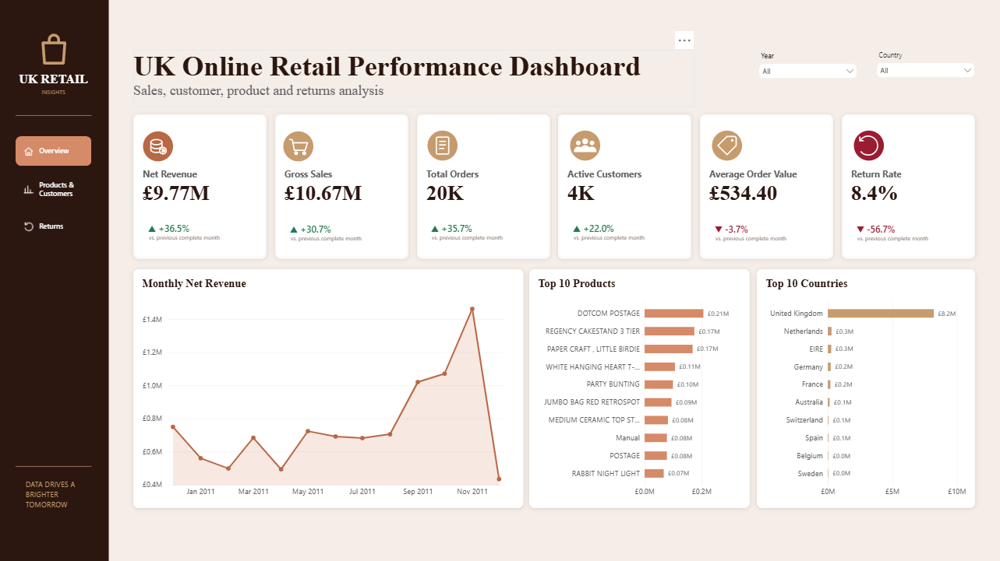
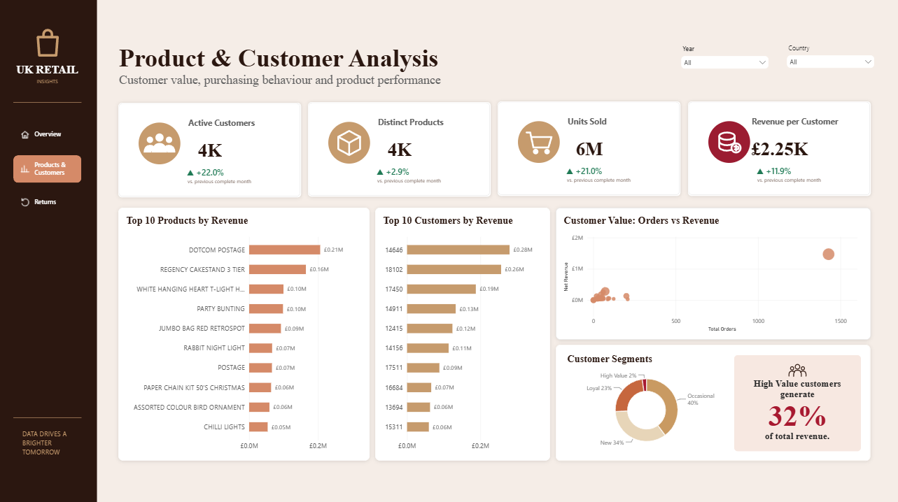
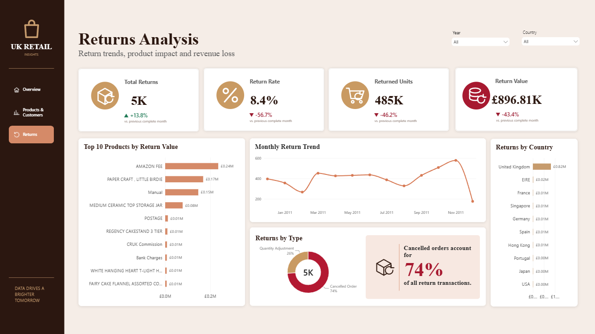
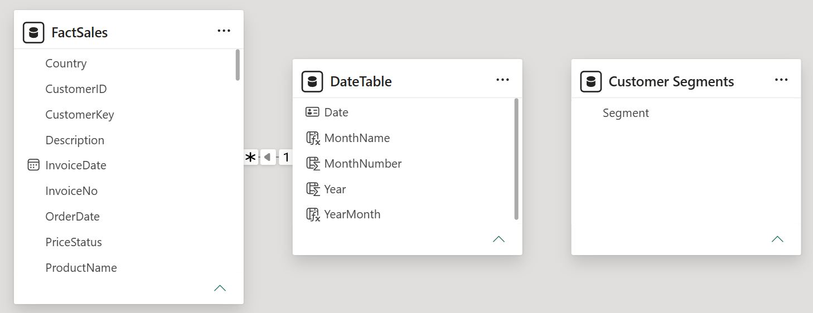

# UK Online Retail Performance Dashboard

An interactive three-page Power BI report created to analyse retail sales, customer behaviour, product performance, and returns. The dashboard turns transactional data into clear business insights using Power Query, data modelling, DAX measures, and interactive navigation.



## Project objectives

This project was designed to answer the following business questions:

- How much revenue and gross sales did the business generate?
- How are sales and returns changing over time?
- Which products, customers, and countries contribute the most revenue?
- What is the average order value and revenue per customer?
- How can customers be grouped by purchasing value?
- Which products and countries generate the highest return value?
- What proportion of return transactions comes from cancelled orders?

## Dashboard pages

### 1. Overview Dashboard

Provides a high-level view of net revenue, gross sales, orders, active customers, average order value, return rate, monthly revenue, leading products, and leading countries.


### 2. Product & Customer Analysis

Explores customer value and product performance through active-customer, product, unit-sales, and revenue-per-customer KPIs. It also includes leading products and customers, an orders-versus-revenue comparison, and customer segmentation.



### 3. Returns Analysis

Tracks total returns, return rate, returned units, return value, monthly return patterns, products with the highest return value, geographic return activity, and return type.



## Key insights

- Net revenue reached **£9.77M**, while gross sales reached **£10.67M**.
- The report contains approximately **20K orders**, **4K active customers**, and **4K distinct products**.
- Average order value was **£534.40**, with revenue per customer of approximately **£2.25K**.
- The **United Kingdom** was the dominant market by revenue.
- **DOTCOM POSTAGE** was the highest-revenue product in the overall analysis.
- The high-value customer group represented a small share of customers but generated approximately **32% of total revenue**.
- Total return value was approximately **£896.81K**, with a return rate of **8.4%**.
- Cancelled orders represented approximately **74% of return transactions**.

## Data preparation

Power Query was used to:

- Clean and trim text fields
- Remove errors and empty records
- Standardise column types
- Create sales and return classifications
- Prepare date, customer, product, country, quantity, and revenue fields for analysis

## Data model

The model contains a central `FactSales` table connected to a dedicated `DateTable`. A disconnected `Customer Segments` table supports dynamic customer segmentation measures.



## Selected DAX calculations

The report includes measures for:

- Net Revenue and Gross Sales
- Total Orders and Active Customers
- Average Order Value and Revenue per Customer
- Month-over-month KPI trends
- Total Returns, Return Rate, Returned Units, and Return Value
- Customer segment counts and revenue share
- Cancelled-order share of returns
- Dynamic trend labels and conditional colours

## Interactive features

- Year and country slicers
- Cross-filtering between visuals
- Page-navigation buttons
- Dynamic month-over-month indicators
- Conditional trend colours
- Customer segmentation

## Tools used

- Microsoft Power BI Desktop
- Power Query
- DAX
- Data modelling
- Data visualisation and dashboard design

## Repository structure

```text
UK_Online_Retail_PowerBI/
├── 01_Overview_Dashboard.png
├── 02_Product_Customer_Analysis.png
├── 03_Returns_Analysis.png
├── 04_Data_Model.png
├── UK_Online_Retail_Dashboard.pbix
└── README.md
```

## Author

**Austin Nwachukwu**  
Data Analyst | Power BI | SQL | Python
